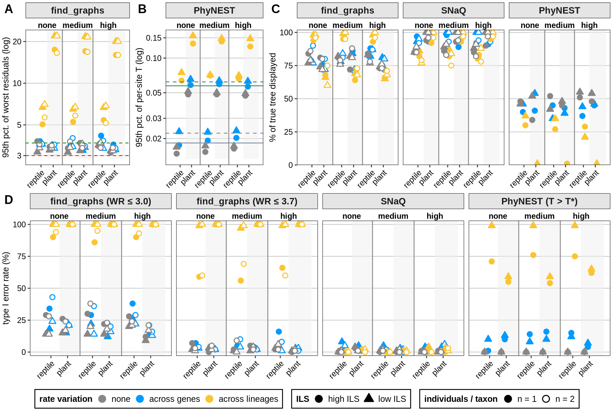

# Simulation for hidden paralogy and rate variation

We simulate phylogenomic datasets to test whether model violations, gene duplication/loss (hidden paralogy) and substitution rate variation, can cause network inference methods (find_graphs, SNaQ, PhyNEST) to detect spurious hybridization when the true history is a tree. Two species trees are used: a reptile tree calibrated from UCE data ([Crawford et al. 2012](https://academic.oup.com/sysbio/article/61/5/717/1735316)) and a basal angiosperm tree calibrated from the Angiosperms353 genes of the Kew Tree of Life Explorer ([Zuntini et al. 2024](https://doi.org/10.1038/s41586-024-07324-0)).

Ready to dive deep? Let's go! 

## Pipeline

| Step | Script | What it does |
|---|---|---|
| 1. Simulation | `simulation.jl` | SimPhy -> filter paralogs -> Seq-Gen -> IQ-TREE -> ASTRAL-IV |
| 2. SNaQ | `snaq.jl` | Network inference at h=0 and h=1, goodness of fit test |
| 3. find\_graphs | `findgraphs.jl` | Admixture graph inference via f-statistics |
| 4. PhyNEST | `phynest.jl` | Network inference at h=0 and h=1 from site patterns |
| 5. Post-processing | `run_postprocessing.jl` | Per-replicate summaries of all parameter sets |
| 6. Tables | `scripts/visuals/visual_tables.R` | Supplementary tables with both species trees |
| 7. Visualization | `scripts/visuals/` | R scripts for the main and supplementary figures |

Details on each script: [scripts/readme.md](scripts/readme.md).

## Reproducing the Analysis

All commands run from the **repo root**. Steps 2, 3 and 4 are independent and can run in parallel after Step 1.

**0. Install dependencies**

Binary executables go in `executables/`. See [software_installation.sh](executables/software_installation.sh). Julia packages are listed in `Project.toml` and `Manifest.toml`.

```bash
bash executables/software_installation.sh   # external binaries
julia --project=. -e 'using Pkg; Pkg.instantiate()'   # Julia packages (pinned in Manifest.toml)
```

**1. Run simulation** (one parameter set, 100 replicates, multiple processors)

The species tree branch lengths and substitution rates were derived from empirical data in [scripts/speciestree/](scripts/speciestree/): `speciestree_reptile.jl` for the reptile tree and `speciestree_angiosperm.jl` for the angiosperm tree.

```bash
julia -p 100 scripts/simulation.jl --tree reptile \
    --dup_rate 0.0003 --loss_rate 0.0003 \
    --ratevar G --n_reps 100 --n_genes 1000 --n_inds 1 --SF 1.0
```

`simulation.jl` runs four steps per replicate: (1) simulate gene trees, (2) simulate sequences, (3) estimate gene trees, (4) estimate the species tree. The workflow is shown below. `--tree reptile` writes to `output/<paramname>/`, `--tree plant` to `output_plant/<paramname>/`.


## Key parameters used in our simulation

Variable parameters:

| Parameter | Values | Notes |
|---|---|---|
| `--tree` | `reptile`, `plant` | Species tree; both have 2Ne = 1000 |
| `--ratevar` | `N`, `G`, `L` | None, gene-specific, lineage-specific |
| `--dup_rate` / `--loss_rate` | reptile: `0.0`, `0.0003`, `0.0004`; plant: `0.0`, `0.0001`, `0.00014` | Per-gene-per-generation; `0.0` disables duplication/loss. The plant tree is longer in generations, hence the lower rates |
| `--SF` | `0.5`, `1.0` | Ne scaling factor; higher = higher ILS |
| `--n_inds` | `1`, `2` | Individuals sampled per species |

Other parameters:

| Parameter | Values | Notes |
|---|---|---|
| `--n_reps` | any int | number of replicates; we used 100 |
| `--n_genes` | any int | number of genes; we used 1000 |
| `--gene_len` | any int | bp length per gene; we used 1000 |

*Note*
1. Output folders are named `DUP<d>-LOS<l>-RV<r>-N_ind<n>-SF<s>-genelen<g>`.
2. Using `-p N` where N matches the number of replicates gives the best efficiency.
3. PhyNEST was run on the 18 settings per tree with one individual per species.

**2. Network inference**

```bash
# SNaQ
julia -p 100 scripts/snaq.jl \
    --dup_rate 0.0003 --loss_rate 0.0003 --ratevar G --n_reps 100 --n_inds 1 --runs 100

# find_graphs
julia -p 100 scripts/findgraphs.jl --tree reptile \
    --dup_rate 0.0003 --loss_rate 0.0003 --ratevar G --n_reps 100 --n_inds 1 --runs 100

# PhyNEST
julia -p 100 scripts/phynest.jl --tree reptile \
    --dup_rate 0.0003 --loss_rate 0.0003 --ratevar G --n_reps 100 --n_inds 1 --runs 100
```

`--runs` controls optimization runs per model: at `--runs 100`, SNaQ uses 10 runs under H=0 (hard-coded) and 100 under H=1; find_graphs and PhyNEST use 100 for both. All three take `--rep_start`/`--rep_end` to run or resume part of the replicates; seeds do not depend on which replicates run first.

**3. Post-process all parameter sets at once**

```bash
julia -p 10 scripts/run_postprocessing.jl --mode simulation
julia -p 10 scripts/run_postprocessing.jl --mode snaq
julia -p 10 scripts/run_postprocessing.jl --mode findgraphs
julia scripts/run_postprocessing.jl --mode phynest
# add --tree plant for the angiosperm settings
```

Or you can postprocess the results from simulation, snaq, find_graphs and PhyNEST individually. This organized the results for visualization and table building. 
For example:

```bash
julia scripts/snaq_postprocess.jl --tree reptile --dup_rate 0 --loss_rate 0 --ratevar N --n_inds 2 --SF 1 --n_reps 100
```

Two more scripts give the inputs of the supplementary tables and figures: `scripts/genetree_tiers.jl` (discordant and misestimated branches per gene tree) and `scripts/findgraphs_bestgraph_trees.R` (the two trees displayed by the best h=1 graph). The per-replicate summaries of all settings used for the paper are in `results/summary_reptile/` and `results/summary_plant/`.

**4. Summarize and visualize**

```bash
julia scripts/summary_simulation.jl
Rscript scripts/visuals/visual_main_figures.R
Rscript scripts/visuals/visual_appendix_figures.R
Rscript scripts/visuals/visual_tables.R
```

The figure scripts live in [scripts/visuals](scripts/visuals/); see [scripts/visuals/readme.md](scripts/visuals/readme.md) for details. They read `results/summary_reptile/` and `results/summary_plant/` and write to `visualization_results/`.

## Major Results



Major figure of the paper, one point per setting, 
reptile and plant results
side by side in each duplication/loss level. 
The figure shows the major findings: 

- A: 95th percentile of the worst residual of the true species tree
  fitted by find_graphs. 
  It is above the usual threshold of 3.0 even without rate variation (3.4 to 3.8), 
  so we also use 3.7, the smallest threshold exceeded by 
  fewer than 5% of the true-tree values. 
  With rate variation across lineages it reaches 5.5 to 6.8 for the reptile tree and
  17 to 22 for the plant tree, 
  far above any threshold.
- B: 95th percentile of the per-site score difference T of PhyNEST, with
  the calibrated thresholds T* (95th percentile over the settings without
  lineage rate variation, one per tree and ILS level). 
  Lineage rate variation pushes T well above T*, 
  mostly for the plant tree at low ILS.
- C: how often the h = 1 network displays the true species tree. 
  SNaQ and find_graphs do so in most replicates (about 80 to 97%). PhyNEST does so less often, 
  and almost never for the plant tree under lineage rate variation.
- D: type I error, the true history being a tree. 
  find_graphs at WR 3.0 wrongly selects a reticulation in 18 to 28% of
  replicates even without rate variation; 
  WR 3.7 brings this to 3 to 4%, but under lineage rate
  variation the error is 80% (reptile) to 100% (plant) at either
  threshold. 
  PhyNEST with T* has 0 to 10% without lineage rate variation
  and 59 to 87% with it. SNaQ stays between 0 and 8% everywhere.

Conclusion: 
Hidden paralogy (the duplication/loss levels on the x axis) 
changes none of this much. 
Substitution rate variation across lineages is what makes
find_graphs and PhyNEST detect reticulations that do not exist, and the
worst residual threshold of find_graphs needs to be calibrated for the
data set at hand. 

## Repository Layout

After running all simulations, the folder structure should be similar to this:

```
<repository-root>/
├── scripts/                        Pipeline scripts (see scripts/readme.md)
│   ├── utilities.jl                Shared Julia helpers across all stages
│   ├── simulation.jl               Entry point: SimPhy + seq-gen + IQ-TREE + ASTRAL
│   ├── simulation_postprocess.jl   Aggregate per-replicate simulation stats
│   ├── genetree_tiers.jl           Discordant / misestimated branches per gene tree
│   ├── snaq.jl                     Entry point: SNaQ runs (parallel)
│   ├── snaq_1rep.jl                Per-replicate SNaQ worker
│   ├── snaq_postprocess.jl         Aggregate per-replicate SNaQ results
│   ├── findgraphs.jl               Entry point: find_graphs runs (parallel)
│   ├── findgraphs_1rep.R           Per-replicate find_graphs worker (R)
│   ├── findgraphs_postprocess.jl   Aggregate per-replicate find_graphs results
│   ├── findgraphs_bestgraph_trees.R  Displayed trees of the best h=1 graph
│   ├── phynest.jl                  Entry point: PhyNEST runs (parallel)
│   ├── phynest_1rep.jl             Per-replicate PhyNEST worker
│   ├── phynest_postprocess.jl      Aggregate per-replicate PhyNEST results
│   ├── run_postprocessing.jl       Run postprocessing across all parameter sets
│   ├── summary_simulation.jl       Cross-setting simulation summary CSV
│   ├── rerun_gof.jl                Re-run goodness-of-fit on existing SNaQ output
│   ├── concatenate_seq.py          Concatenate per-gene sequences into a supermatrix
│   ├── fasta2phylip.py             Alignment to sequential PHYLIP for PhyNEST
│   ├── copy_consensus_inputs.sh    Helper to gather inputs for consensus-tree analysis
│   ├── iqtree.pl                   IQ-TREE wrapper, one run per gene
│   ├── seq-gen.sh                  Seq-Gen wrapper, one run per gene
│   ├── clean.jl                    Remove intermediate output files
│   ├── speciestree/                One-time: true species tree construction
│   │   ├── speciestree_reptile.jl      reptile tree (Crawford et al. 2012 UCEs)
│   │   ├── speciestree_angiosperm.jl   angiosperm tree (Angiosperms353, Kew)
│   │   └── calibrate.r                 external branches and stem of the angiosperm tree
│   ├── visuals/                    R figure and table scripts (see its readme)
│   │   ├── visual_main_figures.R       Fig. 1 and Fig. 2
│   │   ├── visual_appendix_figures.R   Supplementary figures
│   │   ├── visual_tables.R             Supplementary tables
│   │   ├── visual_utilities.R          Shared loader, palette, axis rule
│   │   └── readme.md
│   └── readme.md                   Script-level documentation
│
├── executables/                    External binaries installation
│   ├── software_installation.sh    Installs SimPhy, Seq-Gen, IQ-TREE 2, ASTRAL, snp-sites
│   └── README.md
│
├── envs/phynest/                   Julia environment for PhyNEST (older PhyloNetworks)
│   ├── Project.toml
│   └── Manifest.toml
│
├── simphy-configs/                 SimPhy configuration templates
│   ├── simphysim-conf-master
│   └── README.md
│
├── output/                         Per-replicate outputs, reptile tree (not tracked by Git)
├── output_plant/                   Same for the angiosperm tree (not tracked by Git)
│   │
│   │   # 36 parameter settings per tree
│   │   # 12 DUP/LOSS=0.0 settings
│   ├── DUP0.0-LOS0.0-RVN-N_ind1-SF0.5-genelen1000/
│   ├── ...
│   ├── DUP0.0-LOS0.0-RVL-N_ind2-SF1.0-genelen1000/
│   │
│   │   # 12 medium DUP/LOSS settings (0.0003 reptile, 0.0001 plant)
│   ├── DUP0.0003-LOS0.0003-RVN-N_ind1-SF0.5-genelen1000/
│   ├── ...
│   │
│   │   # 12 high DUP/LOSS settings (0.0004 reptile, 0.00014 plant)
│   ├── DUP0.0004-LOS0.0004-RVN-N_ind1-SF0.5-genelen1000/
│   ├── ...
│   └── DUP0.0004-LOS0.0004-RVL-N_ind2-SF1.0-genelen1000/
│
│       # Each parameter folder shares this structure:
│       # A brief overview of the output folder, but it contains more intermediate files
│       ├── arguments-<paramname>.log       command-line arguments and running times
│       ├── simulation_<paramname>.csv      aggregated simulation results
│       ├── random_seed_[software].txt      per-software seeds
│       ├── findgraphs_summary_results.csv  best k per replicate at WR 3.0
│       ├── screen_<paramname>.log          main worker log
│       ├── screen_<paramname>_worker*.log  per-worker logs
│       ├── rep001/
│       │   ├── genetrees_simphy/           raw SimPhy gene trees
│       │   ├── genetrees_singlecopy/       filtered single-copy gene trees
│       │   ├── seqgenfolder/               Seq-Gen sequence output
│       │   │   └── concate_alignment_rep001.fasta
│       │   ├── iqtreefolder/               IQ-TREE output
│       │   │   └── besttrees.tre
│       │   ├── astralfolder/               ASTRAL species tree
│       │   │   ├── astral.tre
│       │   │   └── astral_mapping.txt
│       │   ├── snaqfolder/
│       │   │   ├── CF_results.csv
│       │   │   ├── id_to_species.csv
│       │   │   ├── H0_output/              SNaQ H=0 run outputs, snaq_gof_results_H0.csv
│       │   │   └── H1_output/              SNaQ H=1 run outputs, snaq_gof_results_H1.csv
│       │   ├── findgraph/
│       │   │   ├── rep001.vcf
│       │   │   ├── eigenstrat_rep001.geno
│       │   │   ├── eigenstrat_rep001.ind
│       │   │   ├── eigenstrat_rep001.snp
│       │   │   ├── rep001_admix0_summary_table.txt
│       │   │   ├── rep001_admix0_unique_graphs.rds
│       │   │   ├── rep001_admix1_summary_table.txt
│       │   │   ├── rep001_admix1_unique_graphs.rds
│       │   │   └── rep001_f2.rds
│       │   └── phynestfolder/
│       │       ├── rep001.phy
│       │       ├── phynest_results.csv
│       │       ├── H0_output/              PhyNEST H=0 run outputs (H0_hc.log, H0_hc.out)
│       │       └── H1_output/              PhyNEST H=1 run outputs
│       ├── rep002/
│       ├── ...
│       ├── # Feel free to add more replicates but in our simulation we used 100
│       └── rep100/
│
├── results/                        The Dryad deposit (see results/readme-dryad.md)
│   ├── readme-dryad.md             Column dictionaries
│   ├── summary_reptile/            Per-replicate summaries, one CSV per setting
│   │   ├── simulation/                 summary_<paramname>.csv
│   │   ├── snaq/                       SNaQ-<paramname>-summary.csv
│   │   ├── findgraphs/                 findgraph-<paramname>.csv
│   │   ├── phynest/                    PhyNEST-<paramname>-summary.csv
│   │   ├── findgraphs_bestgraph/       findgraph-bestgraph-<paramname>.csv
│   │   └── genetrees/                  genetree_tiers_<paramname>.csv
│   ├── summary_plant/              Same for the angiosperm tree
│   └── tables/                     Supplementary tables, per_setting.csv, T_star.csv
│
├── plots/                          Figures and workflow diagrams used in the paper
│   ├── fig1_two_trees.png
│   ├── simulation_workflow.png
│   ├── simulation_workflow.pdf
│   ├── seed_control.png
│   └── README.md
│
├── notes/                          Methodology notes
│   ├── choice-seqgen-parameters.md     Justification for Seq-Gen rate / base-freq params
│   └── consensus_tree.qmd              Building consensus trees (legacy)
│
├── third_party_scripts/            External scripts (Apache 2.0 + MIT)
│   ├── vcf2eigenstrat_biallelic.py
│   ├── vcf2eigenstrat_multiallelic.py
│   ├── interop_admixtools.jl
│   ├── LICENSE-APACHE-2.0.txt
│   ├── mit-license.txt
│   └── readme.md
│
├── Project.toml                    Julia package environment
├── Manifest.toml
├── LICENSE
└── readme.md
```

## Data Availability

The per-replicate summary tables that underlie every figure and table in the paper, for both species trees, are in [`results/`](results/) and deposited on Dryad doi: [10.5061/dryad.dfn2z35h7](https://doi.org/10.5061/dryad.dfn2z35h7).
Column dictionaries and a description of how the CSVs were generated are in
[`results/readme-dryad.md`](results/readme-dryad.md).

To regenerate the CSVs from raw per-replicate outputs, follow the pipeline in
[scripts/readme.md](scripts/readme.md).

## Dependencies

Check [Executables README](executables/README.md) for details!

**Julia** (see `Project.toml`): `PhyloNetworks`, `SNaQ`, `QuartetNetworkGoodnessFit`, `PhyloPlots`, `RCall`, `CSV`, `DataFrames`, `ArgParse`, `Distributed`. PhyNEST needs an older `PhyloNetworks` and has its own environment in `envs/phynest/`, which `phynest_1rep.jl` activates itself, so no `--project` flag is needed.

**External binaries** (symlinked in `executables/`): SimPhy 1.0.2, Seq-Gen 1.3.5, IQ-TREE 2.4.0, ASTER (astral) 1.24.4.8, snp-sites 2.5.1; Python 3 with biopython.

**R**: `admixtools` 2.0.8 (with `igraph` 1.6), `optparse`, `Rcpp`, `ape` for find_graphs; `ggplot2`, `cowplot`, `scales`, `dplyr`, `tidyr`, `readr`, `stringr`, `ggnewscale` for the figures.

## License

Code: MIT License (see [LICENSE](LICENSE)).
`third_party_scripts/vcf2eigenstrat_*.py` is Apache 2.0 (see
[third_party_scripts/LICENSE-APACHE-2.0.txt](third_party_scripts/LICENSE-APACHE-2.0.txt));
`third_party_scripts/interop_admixtools.jl` is MIT (see [third_party_scripts/mit-license.txt](third_party_scripts/mit-license.txt)).
Data deposited on Dryad: CC0 (per Dryad policy).
