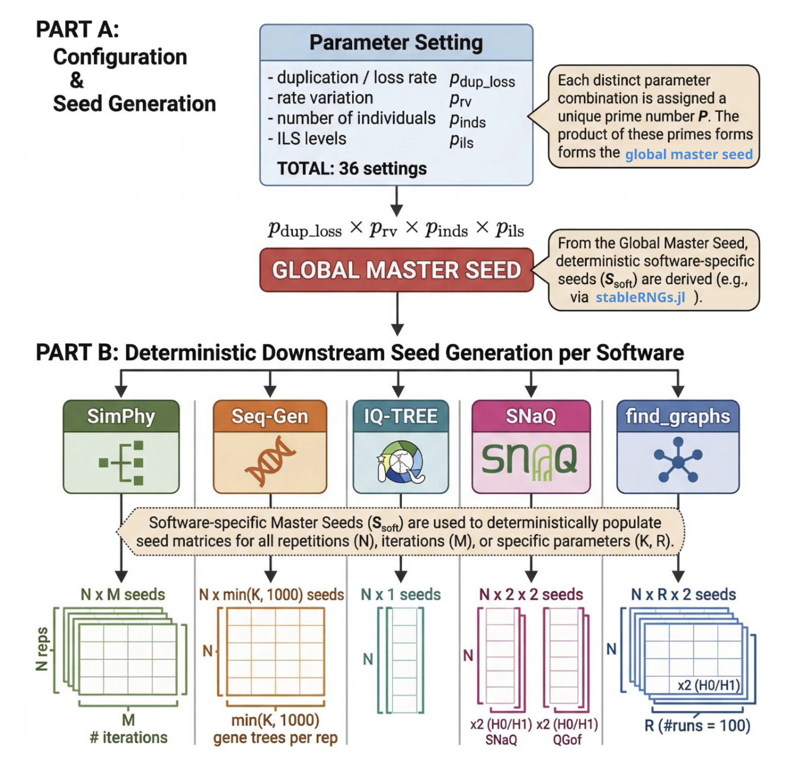

# Scripts

This directory contains the simulation pipeline for the two species 
trees of the study, 
a reptile tree and a basal angiosperm ("plant") tree.

---

## Scripts at a glance

| Script | Language | Purpose |
|---|---|---|
| `speciestree/speciestree_reptile.jl` | Julia | One-time: reptile species tree from the Crawford et al. UCE data, in coalescent units, with substitution rates and lineage-rate multipliers for SimPhy |
| `speciestree/speciestree_angiosperm.jl` | Julia | One-time: angiosperm species tree from the Angiosperms353 data of the Kew Tree of Life; same outputs as above. Calls `speciestree/calibrate.r` for the external branches and the ingroup stem in coalescent units |
| `simulation.jl` | Julia | Major simulation pipeline from gene tree simulation to species tree estimation |
| `simulation_postprocess.jl` | Julia | Postprocess and calculate RF distances for outputs from `simulation.jl` |
| `genetree_tiers.jl` | Julia | Count the discordant and the misestimated branches of every gene tree, per locus category (supplementary tables on gene tree discordance and estimation error) |
| `snaq.jl` / `snaq_1rep.jl` | Julia | SNaQ inference (parallel + per-replicate) |
| `snaq_postprocess.jl` | Julia | Per-replicate summary of the SNaQ results of one setting |
| `findgraphs.jl` / `findgraphs_1rep.R` | Julia/R | find_graphs inference (parallel + per-replicate) |
| `findgraphs_postprocess.jl` | Julia | Per-replicate summary of the find_graphs results of one setting |
| `findgraphs_bestgraph_trees.R` | R | The two trees displayed by the best h=1 graph of every replicate (major and minor), their RF distance to the true tree and their wrong clades |
| `phynest.jl` / `phynest_1rep.jl` | Julia | PhyNEST inference (parallel + per-replicate) |
| `phynest_postprocess.jl` | Julia | Per-replicate summary of the PhyNEST results of one setting |
| `run_postprocessing.jl` | Julia | Batch launcher for all post-processing modes |
| `summary_simulation.jl` | Julia | Concatenate and summarize simulation CSVs |
| `utilities.jl` | Julia | Shared helpers: seed generation, tip manipulation |
| `seq-gen.sh` | Bash | Wrap Seq-Gen calls per gene, called in `simulation.jl` |
| `concatenate_seq.py` | Python | Concatenate per-gene NEXUS alignments into FASTA, called in `simulation.jl` |
| `fasta2phylip.py` | Python | Convert the concatenated FASTA to sequential PHYLIP for PhyNEST, called in `phynest_1rep.jl` |
| `iqtree.pl` | Perl | Batch IQ-TREE across genes; collect best trees, called in `simulation.jl` |
| `visuals/` | R | Figure and table scripts: `visual_main_figures.R`, `visual_appendix_figures.R`, `visual_tables.R` and their helpers `visual_utilities.R` (see `visuals/readme.md`) |
| `copy_consensus_inputs.sh` | Bash | Copy the network files needed for consensus networks out of the output folders |
| `clean.jl` | Julia | Remove the `output/` directory |
| `rerun_gof.jl` | Julia | Re-run goodness-of-fit for specific replicates for sanity check |

---
After setting up following [main readme](../readme.md), let's check our major pipeline:

## Pipeline

0. species trees, once: speciestree/speciestree_reptile.jl and
   speciestree/speciestree_angiosperm.jl
1. simulation.jl: SimPhy, drop the trees with paralogs or missing taxa,
   Seq-Gen, IQ-TREE, ASTRAL
2. simulation_postprocess.jl: RF distances and gene tree statistics, then
   genetree_tiers.jl for the gene tree tables
3. snaq.jl (calls snaq_1rep.jl for each replicate): SNaQ with h=0 and h=1
   on the estimated gene trees, then the goodness of fit test
4. snaq_postprocess.jl
5. findgraphs.jl (findgraphs_1rep.R): find_graphs and qpgraph on the SNPs
   of the concatenated alignment
6. findgraphs_postprocess.jl, then findgraphs_bestgraph_trees.R for the
   displayed trees of the best graph
7. phynest.jl (phynest_1rep.jl): PhyNEST with h=0 and h=1 on the
   concatenated alignment
8. phynest_postprocess.jl

The postprocess scripts give one row per replicate (RF distances, worst
residuals, p-values, T, gammas); run_postprocessing.jl runs them on all
settings at once. summary_simulation.jl puts the simulation summaries of
all settings in one csv, and visuals/ has the R scripts for the figures and
tables, from the summaries in results/summary_reptile/ and
results/summary_plant/.

Run all commands from the **repo root**. Steps 3, 5 and 7 only need the output of step 1 and can run at the same time.

**Step 0 - species tree setup** *(one-time)*

`speciestree_reptile.jl` loads the Crawford reptile phylogeny, calibrates branch lengths in coalescent units, and writes the SimPhy-formatted species tree. `speciestree_angiosperm.jl` does the same for the angiosperm tree from the Angiosperms353 genes (gene trees with IQ-TREE, species tree with ASTRAL, external branches and stem from `calibrate.r`, substitution rates and multipliers from the gene trees). The values of both trees are copied into `simulation.jl`.

---

**Step 1 - simulation**

```bash
julia -p 100 scripts/simulation.jl --tree reptile \
    --dup_rate 0.0003 --loss_rate 0.0003 \
    --ratevar G --n_reps 100 --n_genes 1000 \
    --n_inds 1 --SF 1.0 --gene_len 1000
```

For each replicate: SimPhy generates gene trees, the trees with more than one copy per individual or too few taxa are dropped (SimPhy is re-run until there are enough), Seq-Gen simulates sequences, IQ-TREE estimates gene trees and ASTRAL infers the species tree. `--tree` selects the species tree: `reptile` (outputs in `output/<paramname>/rep*/`) or `plant` (the angiosperm tree, 2Ne = 1000 like the reptile tree, outputs in `output_plant/`). The angiosperm settings use dup/loss rates 1e-4 and 1.4e-4 instead of 3e-4 and 4e-4.

We recommend to have number of processors `-p` match with the `--n_reps` to increase parallelization efficiency.

The inference scripts of steps 3, 5 and 7 read `output/<paramname>/`; for the angiosperm runs, point `output` at the plant folder (`ln -s output_plant output`) in the run folder.

---

**Step 2 - simulation post-processing**

```bash
julia -p 10 scripts/simulation_postprocess.jl --tree reptile \
    --dup_rate 0.0003 --loss_rate 0.0003 \
    --ratevar G --n_reps 100 --n_inds 1
```

Computes RF distances between the true species tree and ASTRAL estimates and gene tree statistics by locus category. Writes `summary_<paramname>.csv` and `genetrees_stats_<paramname>.csv` to the parameter folder. `--tree` (`reptile` or `plant`) selects the true species tree and the output folder; the "noF" columns drop F for the reptile tree and B for the plant tree.

```bash
julia scripts/genetree_tiers.jl --tree reptile \
    --dup_rate 0.0003 --loss_rate 0.0003 \
    --ratevar G --n_inds 2 --SF 0.5
```

Reads `genetrees_stats_<paramname>.csv` written above and counts, per locus category, how many gene trees have 0, 1, 2, ... branches discordant with the species tree and 0, 1, 2, ... branches misestimated by IQ-TREE. With two individuals per taxon the 8-taxon subtrees of every gene tree are enumerated again (the stored distance is their mean). Writes `genetree_tiers_<paramname>.csv` to the parameter folder; the files of all settings go to `results/summary_<tree>/genetrees/` for the supplementary tables (`visuals/visual_tables.R`). About 30 s per setting with one individual per taxon, 3 to 4 min with two.

---

**Step 3 - SNaQ**

```bash
julia -p 100 scripts/snaq.jl \
    --dup_rate 0.0003 --loss_rate 0.0003 \
    --ratevar G --n_reps 100 --runs 100 --n_inds 1
```

Runs SNaQ at h=0 (10 runs, the ASTRAL tree is a good start) and h=1 (`--runs` runs) per replicate (via `snaq_1rep.jl`), then the goodness of fit test of both networks. Optional: use `--rep_start`/`--rep_end` to resume a partial run:

```bash
julia -p 50 scripts/snaq.jl \
    --dup_rate 0.0003 --loss_rate 0.0003 \
    --ratevar G --n_reps 100 --runs 100 --n_inds 1 \
    --rep_start 51 --rep_end 100
```
The above will only run rep 51 to 100. Seeds are pre-determined so results are deterministic no matter which replicate runs first.

---

**Step 4 - SNaQ post-processing**

```bash
julia scripts/snaq_postprocess.jl --tree reptile \
    --dup_rate 0.0003 --loss_rate 0.0003 \
    --ratevar G --n_reps 100 --n_inds 1
```

Summarizes the per-replicate SNaQ results into `SNaQ-<paramname>-summary.csv` (goodness-of-fit p-values of h=0 and h=1, scores, gamma, RF distances of the networks to the true tree and to the alternative topologies, placement of the reticulation), and builds the consensus tree and network over the replicates. `--tree` selects the true tree, its alternative topologies and the pruned taxon as in step 2.

---

**Step 5 - find\_graphs**

```bash
julia -p 100 scripts/findgraphs.jl --tree reptile \
    --dup_rate 0.0003 --loss_rate 0.0003 \
    --ratevar G --n_reps 100 --runs 100 --n_inds 1
```

Calls snp-sites on the concatenated alignment, converts to eigenstrat, then runs `find_graphs()` and `qpgraph()` from `admixtools` per replicate (via `findgraphs_1rep.R`), with one jackknife block per gene (1000 bp). It can also take `--rep_start` and `--rep_end` as SNaQ; `--tree` selects the true tree used for the per-replicate comparisons.

---

**Step 6 - find\_graphs post-processing**

```bash
julia scripts/findgraphs_postprocess.jl --tree reptile \
    --dup_rate 0.0003 --loss_rate 0.0003 \
    --ratevar G --n_reps 100 --n_inds 1 \
    --new_WR_threshold 3.7
```

Adds RF distances, calculates summary statistics and applies worst-residual model selection (h=0 vs h=1 vs h>1) at the default threshold WR <= 3.0 and at the specified `--new_WR_threshold`, and writes `findgraph-<paramname>.csv`. Use `--output_dir` if the setting folders are not under `output/` (or `output_plant/`).

```bash
Rscript scripts/findgraphs_bestgraph_trees.R --tree reptile \
    --dup_rate 0.0003 --loss_rate 0.0003 \
    --ratevar G --n_inds 1 --SF 1.0
```

For every replicate, takes the best-scoring h=1 graph and writes its two displayed trees (the major tree, obtained by removing the minor admixture edge, and the minor tree), their RF distance to the true species tree, the clades of each that the true tree lacks, the two inheritance probabilities and the hybrid taxon and donors, to `findgraph-bestgraph-<paramname>.csv`. The files of all settings go to `results/summary_<tree>/findgraphs_bestgraph/` for the supplementary figure H and the table of `visuals/`. Rates are given as written in the folder names (`0.0`, `0.0003`, `0.00014`).

---

**Step 7 - PhyNEST**

```bash
julia -p 100 scripts/phynest.jl --tree reptile \
    --dup_rate 0.0003 --loss_rate 0.0003 \
    --ratevar G --n_reps 100 --runs 100 --n_inds 1
```

Converts the concatenated alignment to PHYLIP and runs PhyNEST at h=0 (started from the ASTRAL tree) and h=1 (started from the h=0 result) per replicate (via `phynest_1rep.jl`), with `--runs` search runs under each model. Records the composite likelihood of both models, of the true species tree, and the estimated networks; no threshold is applied at this stage. `--rep_start`/`--rep_end` work as for SNaQ. PhyNEST activates its own environment in `envs/phynest` (it pins an older `PhyloNetworks`), so no `--project` flag is needed. Only one individual per species was used in the paper.

---

**Step 8 - PhyNEST post-processing**

```bash
julia scripts/phynest_postprocess.jl --tree reptile \
    --dup_rate 0.0003 --loss_rate 0.0003 \
    --ratevar G --n_reps 100 --n_inds 1
```

Adds RF distances of the h=0 tree and of both trees displayed in the h=1 network to the true species tree (and to the alternative placements of the pruned taxon), the hybrid clade and donors, the number of search runs that reached the best score, and the number of sites M of the concatenated alignment (from the PhyNEST log) together with the per-site score difference `T_per_site` = (score(h=0) - score(h=1)) / M, since the raw difference (column `T`) grows linearly with M and M is smaller in replicates where fewer loci were retained. Writes `PhyNEST-<paramname>-summary.csv`. Use `--output_dir` if the PhyNEST output folders are not under `output/`.

The model-selection threshold T* of PhyNEST (95th percentile of `T_per_site` pooled over the settings without lineage rate variation, per tree and ILS level) is computed by the R scripts in `visuals/` from these summaries.

---

## Batch post-processing: `run_postprocessing.jl`

After generating output for all parameter sets, use `run_postprocessing.jl` to run the appropriate post-processing script across every parameter folder in `output/` at once.

```bash
julia scripts/run_postprocessing.jl --mode simulation
julia scripts/run_postprocessing.jl --mode snaq
julia scripts/run_postprocessing.jl --mode findgraphs
julia scripts/run_postprocessing.jl --mode phynest
```

This scans `output/` for folders matching the `DUP*-LOS*-RV*-N_ind*-SF*-genelen*` naming pattern, calls `<mode>_postprocess.jl` for each, copies the resulting summary CSV to `<mode>_summary/`, and (for snaq and findgraphs) collects consensus network PDFs into a central directory. Use `--n_reps`, `--output_dir`, or `--saved_path` to override defaults. `--tree plant` is forwarded to the sub-scripts, which then use the plant true tree and its alternative topologies and drop B, F, G instead of F, G, H in the "noF/noG/noH" columns (names unchanged); the defaults become `--output_dir output_plant` and `--saved_path <mode>_summary_plant`:

```bash
julia scripts/run_postprocessing.jl --mode simulation --tree plant
julia scripts/run_postprocessing.jl --mode snaq --tree plant
julia scripts/run_postprocessing.jl --mode findgraphs --tree plant
```

The snaq and findgraphs post-processing call R through RCall. If R was installed with conda and RCall fails with `CXXABI_1.3.15 not found`, preload conda's libstdc++ first, e.g. `export LD_PRELOAD=$CONDA_PREFIX/lib/libstdc++.so.6`.

The per-replicate summaries used for the paper are collected in `results/summary_reptile/<mode>/` and `results/summary_plant/<mode>/` (one CSV per setting), which the scripts in `visuals/` read.

---

## Summary script: `summary_simulation.jl`

After post-processing, this script concatenates the simulation summaries across all parameter sets (gene-tree counts, hidden-paralogy categories, RF distances, branch-length statistics).

```bash
julia scripts/summary_simulation.jl
julia scripts/summary_simulation.jl --tree plant
```

It reads the per-parameter CSVs from `simulation_summary/` (`simulation_summary_plant/` with `--tree plant`) and writes `results/summary_concatenated.csv` (`_plant`). The cross-setting statistics of SNaQ, find_graphs and PhyNEST (type I error rates, topology recovery, worst residual, T and gamma by factor level) are computed by `visuals/visual_main_figures.R` and `visuals/visual_tables.R` directly from the per-replicate summaries of both trees.

---

## Reproducibility

All seeds are derived deterministically from parameter values, so every run is reproducible. See the [seed control diagram](../plots/seed_control.png) below.



For a brief overview of the study and major results, see the [main readme](../readme.md).
